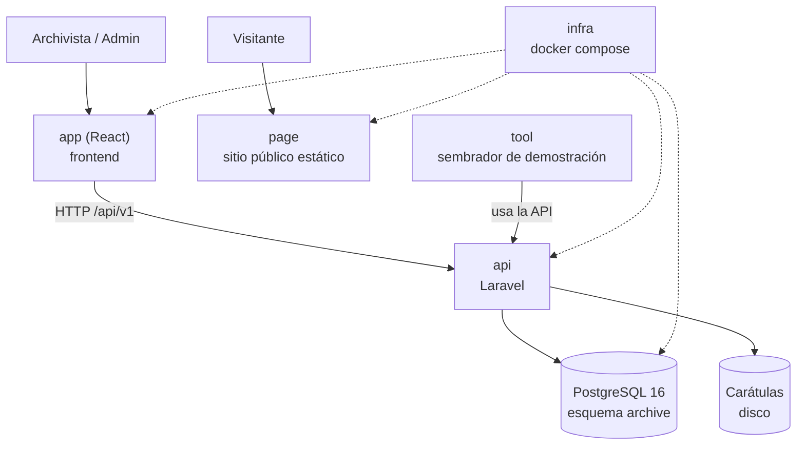
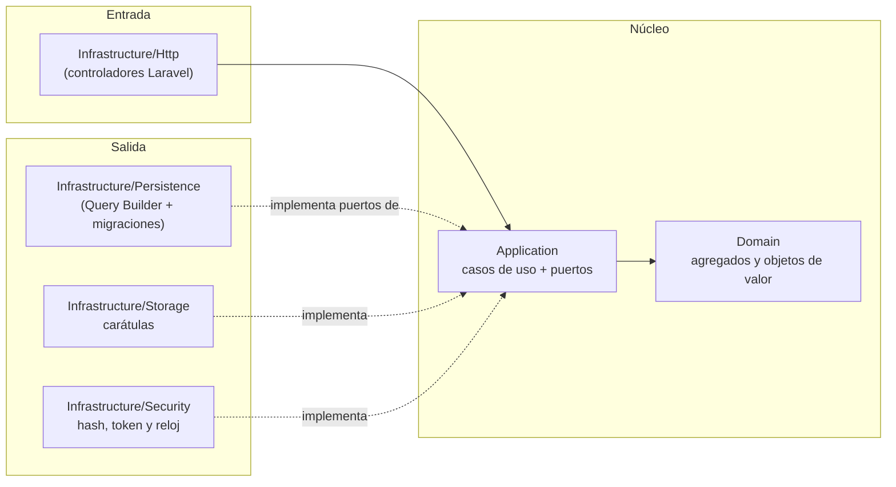
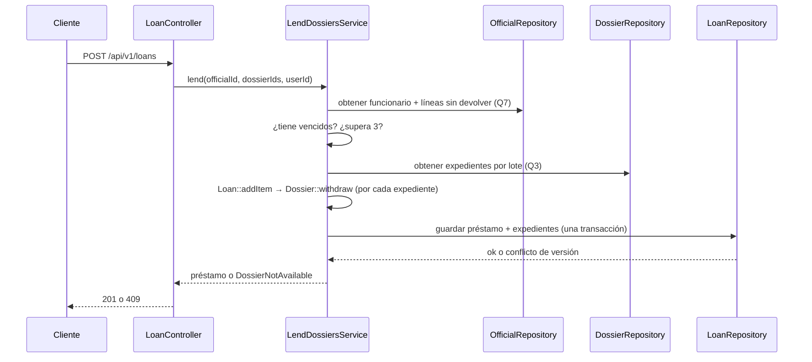

# Arquitectura — Archive (Laravel + React)

Arquitectura **hexagonal** (puertos y adaptadores). Las reglas de dependencia son los artículos I a III de
[`constitution.md`](constitution.md).

## 0. El sistema en una imagen



| Carpeta | Papel | Se prueba con |
|---|---|---|
| `docs` | La especificación | Que leerla baste para construir |
| `api` | Reglas de negocio y contrato HTTP | Pruebas de dominio, aplicación, contrato, arquitectura y concurrencia |
| `app` | Pantallas de operación | Recorrido de punta a punta: login → prestar → devolver → reporte |
| `page` | Presentación pública, sin llamar a la API | Que se vea bien en móvil y en escritorio |
| `infra` | `docker compose up` y la base vacía | Que arranca con un solo comando |
| `tool` | Datos de demostración (expedientes, funcionarios, préstamos) | Que tras correrlo haya vencidos y filas en el reporte |

**Las cinco ideas que sostienen el diseño**

1. **El préstamo es un hecho inmutable**: solo cambia `returned_at` de una línea.
2. **Las unidades se descuentan y se devuelven en la misma operación** que crea o cierra la línea.
3. **El estado se calcula**: `open`, `overdue` y `closed` no están en la base.
4. **Lo congelado no sigue al catálogo**: el reporte de noviembre no cambia porque en diciembre se renombre un expediente.
5. **La base es la última barrera**: si salta el `CHECK` de unidades, algo escribió por fuera del sistema.

## 1. Capas y dependencias



Las flechas de dependencia apuntan **hacia adentro**. `PortBindingsServiceProvider` es el único que ve las dos mitades.

## 2. Estructura de carpetas

```text
api/app/
├── Domain/                 # Dossier, Loan, LoanItem, Official, User, Role, LoanStatus
│   ├── ValueObject/        # FilingNumber, Quantity, DateRange
│   └── Exception/          # DossierNotAvailable, OfficialHasOverdue, OfficialLimitExceeded, …
├── Application/
│   ├── Port/               # DossierRepository, LoanRepository, OfficialRepository, UserRepository,
│   │                       # CategoryReader, ReportReader, Clock, PasswordHasher, TokenIssuer, CoverStorage
│   └── Service/            # LoginService, CreateArchivistService, CreateDossierService, UpdateDossierService,
│                           # SearchDossiersService, WithdrawDossierService, DossierCoverService,
│                           # CreateOfficialService, LendDossiersService, ReturnItemService,
│                           # OverdueItemsService, MostRequestedReportService
├── Infrastructure/
│   ├── Http/               # Controllers/, Middleware/ (JWT y rol), Requests/, ErrorRenderer
│   ├── Persistence/        # repositorios Db* con el Query Builder (DbDossierRepository, DbLoanRepository, …)
│   ├── Storage/            # LocalCoverStorage
│   └── Security/           # BcryptPasswordHasher, JwtTokenIssuer, SystemClock
├── Console/                # BootstrapAdminCommand (archive:bootstrap-admin)
└── Providers/
    └── PortBindingsServiceProvider.php   # único punto de composición (artículo III)
```

## 3. Agregados

| Raíz | Contiene | Invariantes que defiende |
|---|---|---|
| `Dossier` | `FilingNumber`, unidades totales y disponibles, versión, baja lógica | disponibles entre 0 y total; total ≥ 1; título no vacío |
| `Loan` | colección de `LoanItem` | 1 a 3 líneas; sin expediente repetido; vencimiento a 5 días; inmutable salvo devolución |
| `Official` | documento | documento obligatorio y único |
| `User` | rol, hash | nombre normalizado; rol en (`admin`, `archivist`) |

`Loan::addItem()` llama a `Dossier::withdraw()` antes de agregar la línea: descontar la unidad y crear la línea son
**una sola operación**. `Loan::returnItem()` llama a `Dossier::restock()` una sola vez por línea.

## 4. Flujo: registrar un préstamo



## 5. Errores

El dominio y la aplicación lanzan excepciones propias (`DossierNotAvailable`, `OfficialHasOverdue`,
`OfficialLimitExceeded`, …). **Solo** el adaptador HTTP (`ErrorRenderer`, registrado en `bootstrap/app.php`) las traduce
al cuerpo único y al código de estado de [`api-contract.md`](api-contract.md). Un error de Laravel nunca llega al cliente
con su forma original.

## 6. Qué no hay

Sin eventos, sin colas, sin caché, sin microservicios, sin multi-tenencia. Se agregan si un requisito lo pide, no antes.
