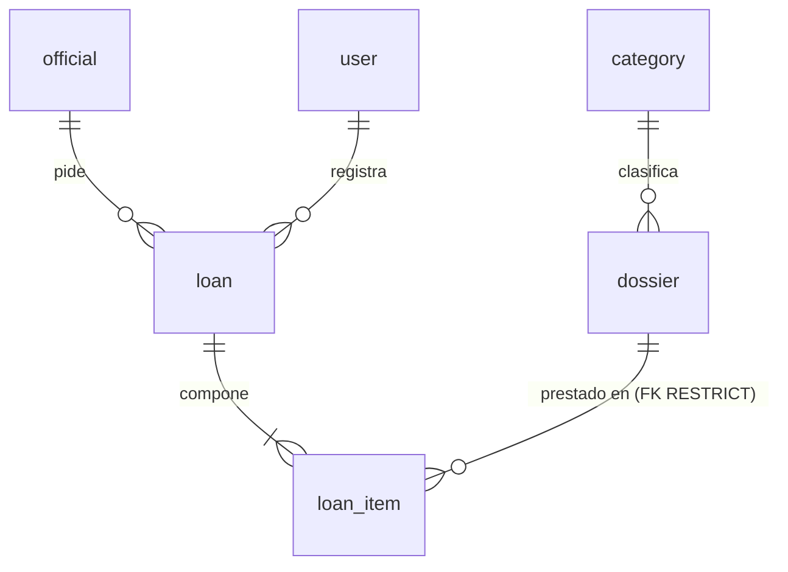

# Modelo de datos — Archive

**Es el único lugar donde vive el modelo de datos.** Quien implemente no necesita abrir el código ni conectarse al motor
para saber qué hay, de qué tipo y con qué regla.

- Motor de referencia: PostgreSQL 16. Esquema `archive`. Servidor en UTC.
- Se rige por [`constitution.md`](constitution.md) y [`spec.md`](spec.md). Si algo contradice este documento, gana este
  documento (y si el motor lo contradice, gana el motor: artículo X).

Cada regla lleva una de **tres marcas**: **motor** (la impone la base), **solo dominio** (solo el código) y
**pendiente (T-xx)** (la pone esa tarea de [`tasks.md`](tasks.md)).

---

## 0. Convención de nombres

| Elemento | Convención | Ejemplo |
|---|---|---|
| Tabla | `snake_case`, inglés, **singular** | `loan_item` |
| Columna | `snake_case`, inglés, singular, ASCII | `due_at` |
| Restricción escrita a mano | `ck_{tabla}_{regla}` | `ck_dossier_available_range` |
| Esquema | `archive` | `archive.loan` |

`user` se escribe `archive."user"` en SQL a mano, porque es palabra reservada en PostgreSQL. Laravel lo entrecomilla solo.
La tabla técnica de Laravel vive en `public.migrations` (Laravel la crea antes de que exista el esquema `archive`); no
forma parte del dominio. La conexión usa `search_path = archive,public`.

## 1. Glosario

| Término | Definición | Dónde vive |
|---|---|---|
| **Expediente** | Carpeta del archivo, con asunto, dependencia productora, número de radicado, categoría, unidades y carátula opcional | `dossier` |
| **Número de radicado** | Identificador público del expediente con el formato `AAAA-NNNNNN` | `dossier.filing_number` |
| **Categoría** | Clasificación fija de cinco (contratos, personal, predial, actas, jurídico), sembrada, sin mantenimiento | `category` |
| **Unidad** | Copia física del expediente (original o copia de consulta). Se cuenta, no se identifica | `dossier.total_units`, `dossier.available_units` |
| **Funcionario** | Empleado de la alcaldía que pide prestado. No inicia sesión | `official` |
| **Préstamo** | Hecho consumado: quién lo pidió, quién lo registró y cuándo | `loan` |
| **Línea de préstamo** | Un expediente dentro de un préstamo, con su vencimiento y su devolución | `loan_item` |
| **Estado del préstamo** | `open`, `overdue` o `closed`. **Se calcula, no se almacena** | sin columna |
| **Usuario** | Operador interno con rol `admin` o `archivist` | `user` |
| **Congelado** | Copia del valor en el instante del préstamo; no sigue al catálogo | `loan_item.dossier_title`, `filing_number`, `category_name` |
| **Testigo de versión** | Número que sube en cada cambio de unidades; detecta escrituras simultáneas | `dossier.version` |

## 2. Entidades y relaciones



Seis entidades, seis tablas. No hay tabla de reporte, de sanciones ni de auditoría.

## 3. Modelo físico

Ninguna columna lleva `DEFAULT`: los valores los pone el dominio.

**`category`**: semilla de solo lectura.

| Columna | Tipo | Nulable | Nota |
|---|---|---|---|
| `id` | `uuid` | no | PK. Identificadores literales (ver §9) |
| `name` | `varchar(120)` | no | Único |

**`dossier`**

| Columna | Tipo | Nulable | Nota |
|---|---|---|---|
| `id` | `uuid` | no | PK |
| `title` | `varchar(250)` | no | Asunto del expediente. Recortado por el dominio |
| `producing_office` | `varchar(200)` | no | Dependencia productora |
| `filing_number` | `char(11)` | no | Formato `AAAA-NNNNNN`. Único entre expedientes activos (índice parcial) |
| `category_id` | `uuid` | no | FK restrictiva a `category` |
| `total_units` | `integer` | no | ≥ 1 |
| `available_units` | `integer` | no | Entre 0 y `total_units` |
| `version` | `integer` | no | Testigo de versión; arranca en 1 y sube en cada cambio ([ADR-002](adr/adr-002-concurrencia-optimista.md)) |
| `cover_key` | `varchar(512)` | **sí** | Clave opaca de la carátula; nunca ruta ni bytes; nunca cadena vacía |
| `deleted_at` | `timestamptz` | sí | Baja lógica. Nula = activo |

**`official`**

| Columna | Tipo | Nulable | Nota |
|---|---|---|---|
| `id` | `uuid` | no | PK |
| `full_name` | `varchar(200)` | no | |
| `document_number` | `varchar(30)` | no | Único |

**`loan`**

| Columna | Tipo | Nulable | Nota |
|---|---|---|---|
| `id` | `uuid` | no | PK |
| `official_id` | `uuid` | no | FK restrictiva a `official` |
| `loaned_by_user_id` | `uuid` | no | FK restrictiva a `user` |
| `loaned_at` | `timestamptz` | no | Instante del préstamo |

**`loan_item`**

| Columna | Tipo | Nulable | Nota |
|---|---|---|---|
| `id` | `uuid` | no | PK |
| `loan_id` | `uuid` | no | FK con `ON DELETE CASCADE` |
| `dossier_id` | `uuid` | no | FK restrictiva a `dossier` |
| `dossier_title` | `varchar(250)` | no | Congelado; mismo ancho que `dossier.title` |
| `filing_number` | `char(11)` | no | Congelado |
| `category_name` | `varchar(120)` | no | Congelado; **sin FK a propósito** |
| `due_at` | `timestamptz` | no | `loaned_at` + 5 días, calculado por el dominio |
| `returned_at` | `timestamptz` | **sí** | Nula mientras no se devuelve |

**`user`**

| Columna | Tipo | Nulable | Nota |
|---|---|---|---|
| `id` | `uuid` | no | PK |
| `username` | `varchar(120)` | no | Único, minúsculas, recortado |
| `password_hash` | `varchar(512)` | no | Nunca se indexa |
| `role` | `varchar(40)` | no | `admin` o `archivist` |

Reglas transversales: **todas las marcas de tiempo son `timestamptz`**. **No hay columnas de auditoría**
(`created_at`/`updated_at`) porque ningún requisito las pide; los modelos Eloquent declaran `$timestamps = false`.

## 4. Restricciones e índices: dónde vive cada regla

| Regla | Objeto | Marca |
|---|---|---|
| Claves primarias de las seis tablas | `*_pkey` | **motor** |
| `category.name` único | índice único | **motor** |
| `official.document_number` único | índice único | **motor** |
| `user.username` único | índice único | **motor** |
| `filing_number` único entre activos | índice único parcial `WHERE deleted_at IS NULL` | **motor** |
| `filing_number` con formato `AAAA-NNNNNN` | `ck_dossier_filing_number_format` (`~ '^[0-9]{4}-[0-9]{6}$'`) | **motor** |
| `dossier.category_id` → `category.id` RESTRICT | FK | **motor** |
| `loan.official_id` → `official.id` RESTRICT | FK | **motor** |
| `loan.loaned_by_user_id` → `user.id` RESTRICT | FK | **motor** |
| `loan_item.loan_id` → `loan.id` CASCADE | FK | **motor** |
| `loan_item.dossier_id` → `dossier.id` RESTRICT | FK | **motor** |
| `0 <= available_units <= total_units` | `ck_dossier_available_range` | **motor**: última barrera de concurrencia |
| `total_units >= 1` | `ck_dossier_total_positive` | **pendiente (T-18)** · hoy solo dominio |
| Único `(loan_id, dossier_id)` | índice único | **motor** |
| `role` en (`admin`, `archivist`) | `ck_user_role` | **pendiente (T-18)** · hoy solo dominio |
| Máximo 3 sin devolver por funcionario | — | **solo dominio** (no se puede expresar en un `CHECK`) |
| Funcionario con vencidos no pide | — | **solo dominio** |
| Descontar la unidad y crear la línea son una operación | — | **solo dominio** (una transacción) |
| Un préstamo tiene de 1 a 3 líneas | — | **solo dominio** |
| Préstamos y devoluciones inmutables, salvo `returned_at` | — | **solo dominio** (no existe operación para cambiarlos) |

Índices de acceso: `dossier (category_id, title)` parcial sobre activos; `loan (loaned_at)`; `loan (official_id)`;
`loan_item (dossier_id)`; `loan_item (due_at) WHERE returned_at IS NULL` para vencidos.

## 5. Política de claves foráneas

| # | FK | `ON DELETE` | Por qué |
|---|---|---|---|
| FK-1 | `dossier.category_id` | RESTRICT | Una categoría con expedientes no se elimina |
| FK-2 | `loan_item.loan_id` | CASCADE | Composición: la línea no vive sin su préstamo (nunca se dispara: no se borran préstamos) |
| FK-3 | `loan_item.dossier_id` | RESTRICT | Barrera de última instancia: un borrado manual no puede dejar huérfano el histórico |
| FK-4 | `loan.official_id` | RESTRICT | El funcionario de un préstamo no desaparece |
| FK-5 | `loan.loaned_by_user_id` | RESTRICT | Quién registró el préstamo es un dato de control |

`ON UPDATE NO ACTION` en todas: las claves son UUID generados por la aplicación y no cambian.

## 6. Patrones de acceso

| # | Patrón | Frecuencia |
|---|---|---|
| Q1 | Buscar expedientes (texto, categoría, activos, orden por título, paginado) | Alta |
| Q2 | Expediente por id | Alta |
| Q3 | Expedientes por lote de ids (antes de prestar) | Alta, punto de contención |
| Q4 | Listar categorías | Alta |
| Q5 | Préstamo con sus líneas | Media |
| Q6 | Préstamos por rango, estado y funcionario | Alta |
| Q7 | Líneas sin devolver de un funcionario (conteo y vencidos) | Alta, en cada préstamo |
| Q8 | Vencidos globales | Media |
| Q9 | Reporte: más solicitados por rango | Alta, la más costosa |
| Q10 | Usuario por nombre | Alta, en cada inicio de sesión |

## 7. Privacidad y retención

| Tabla | Atributo | Clasificación | Manejo |
|---|---|---|---|
| `user` | `username` | Dato personal | Acceso restringido |
| `user` | `password_hash` | **Secreto** | Jamás en logs ni respuestas; nunca se indexa |
| `official` | `full_name`, `document_number` | **Dato personal** (Ley 1581 de 2012) | Solo `admin` y `archivist`; **nunca** en el reporte ni en endpoints públicos |
| `loan`, `loan_item` | todos | Operativos; `official_id` es dato personal indirecto | Retención indefinida |
| `dossier`, `category` | todos | Internos de la entidad | Baja lógica / sin borrado |

El reporte agrupa por expediente: **no expone funcionarios ni archivistas**.

**Retención:** préstamos y líneas nunca se borran; los expedientes solo tienen baja lógica; el archivo de la carátula es el
**único** dato que se borra físicamente. Orden obligatorio: primero se anula `cover_key` y se confirma la transacción;
después se borra el archivo.

## 8. Auditoría

El sistema **no** lleva `created_at`/`updated_at`. Los instantes de negocio ya tienen columna: `loan.loaned_at`,
`loan_item.returned_at` y `dossier.deleted_at`. Si aparece una pregunta del tipo «¿quién cambió este título?», la decisión
vuelve al propietario del producto.

## 9. Estrategia de semilla

Las **cinco categorías** van en la migración inicial, con identificadores fijos:

| `id` | `name` |
|---|---|
| `11111111-1111-4111-8111-111111111111` | Contratos |
| `22222222-2222-4222-8222-222222222222` | Personal |
| `33333333-3333-4333-8333-333333333333` | Predial |
| `44444444-4444-4444-8444-444444444444` | Actas |
| `55555555-5555-4555-8555-555555555555` | Jurídico |

**La base no siembra el administrador inicial**: lo crea el comando `php artisan archive:bootstrap-admin` al arrancar,
con credenciales de entorno (`ADMIN_USERNAME`, `ADMIN_PASSWORD`), porque el hash solo puede producirlo el puerto de hash.
El sembrador de datos de demostración (`tool`) usa la **API**, nunca SQL directo.

## 10. Cómo se comprueba que este documento no miente

```sql
-- Debe devolver las columnas de §3, sin ningún DEFAULT
SELECT table_name, ordinal_position, column_name, data_type, is_nullable, column_default
FROM information_schema.columns
WHERE table_schema = 'archive' AND table_name <> 'migrations' ORDER BY 1, 2;

-- Restricciones: PK, FK y CHECK
SELECT c.conrelid::regclass, c.conname, c.contype, pg_get_constraintdef(c.oid)
FROM pg_constraint c JOIN pg_namespace n ON n.oid = c.connamespace
WHERE n.nspname = 'archive' ORDER BY 1, 3, 2;

-- Índices
SELECT tablename, indexname, indexdef FROM pg_indexes WHERE schemaname = 'archive' ORDER BY 1, 2;
```

Si una regla marcada **motor** no aparece, alguien la borró. Si una marcada **solo dominio** aparece, ya se bajó a la base y
hay que reclasificarla. Gana el motor: el documento está roto y se corrige el documento.
